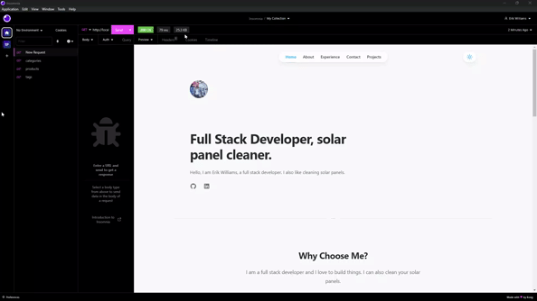

# Nextjs Tailwind Personal Website

This is a [Next.js](https://nextjs.org/), [Tailwind CSS](https://tailwindcss.com/) template intended to be used as a portfolio or personal website. It comes out of the box configured with the latest technologies, tools, and best practices. It's built to be easily configured, customized and extended. It's also fully responsive and mobile friendly.

It's built with the latest technologies and tools, fully responsive and mobile friendly, and has a built in dark/light mode, so you can be sure that your website will look great on any device.

Inside of `data/siteMetadata.js` you'll find a JSON object to easy change the websites data. You can add your name, title, description, social media links, and more. 

```js
const siteMetadata = {
  title: 'Nextjs Tailwind Portfolio',
  description:
    'This is where you can learn about me.',
  author: 'Erik Williams',
  authorHeadline: 'Full Stack Developer, amateur audio engineer',
  authorAbout:
    "Hi, I'm Erik, a full stack developer. I created this to help my mom create a website for all her crazy business ideas. I hope you like it!",
  authorAboutExtended:
    "Erik is American-born, living in South East Los Angeles.  \n \n  In his personal life, Erik is an avid martial arts and audio nut. He enjoys making music in his sparetime as well as practice martial arts. When he's not codin or exercising, Erik can be found playing PC videogames. I also love being a dad.",
  socials: {
    github: 'https://github.com/EPW80',
    linkedin: 'https://www.linkedin.com/in/erik-parra-williams/',
  },
  //...
}
```

## Getting Started

Clone the repository and install the dependencies:

```bash
npm install
```

Run the development server:

```bash
npm run dev
```

Open [http://localhost:3000](http://localhost:3000) with your browser to see the result.

## Demo



## Contributor

Erik Williams


